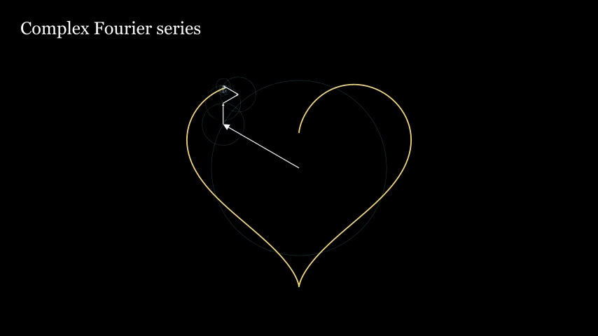

# math_explainer

A production environment for 3Blue1Brown-*style* math explainer videos: Manim animation,
AI narration (AI33 / ElevenLabs voices), licensed music (Epidemic Sound), and every
animation beat synced to the narration's word timings.

It's built on a teardown of two of the most successful math videos on YouTube:
[But what is the Fourier Transform?](https://www.youtube.com/watch?v=spUNpyF58BY) (12.7 M views) and
[But what is a Fourier series?](https://www.youtube.com/watch?v=r6sGWTCMz2k) (19 M views).

## Setup (macOS, once)
```bash
./setup.sh              # ffmpeg, cairo/pango, Python 3.12 env, the `explainer` command
./setup.sh --latex      # optional: LaTeX for real maths typesetting (BasicTeX, ~400 MB)
# then paste your keys into .env (AI33_API_KEY, EPIDEMIC_SOUND_MCP_API_KEY)
source .venv/bin/activate
explainer doctor        # checks tools, keys, credits
```

## Make a video
```bash
explainer new fourier_short          # videos/fourier_short/: script.txt, scene.py, video.toml, beats.md
#   1. outline beats.md   2. write script.txt   3. animate scene.py
explainer render fourier_short       # fast 480p draft (timings estimated from the script)
explainer build fourier_short --hq   # AI voice → music → 1080p60 render → mix
# → videos/fourier_short/fourier_short_final.mp4 + thumbnail.png
```
Each step can also run alone: `voice`, `music`, `render`, `mix`. `explainer voices` lists narrators.

## Syncing animation to narration
```python
from explainer import *

class Main(VoiceScene):
    def construct(self):
        self.play_at("how", Write(title))                  # starts on the word "how"
        self.play_until("pairs", Create(web), end=True)    # finishes as "pairs" ends
        self.play_at("two hundred", FadeIn(counter))       # phrases work
        self.hold_end()                                    # hold the payoff frame
```
Re-record the voice and every beat re-syncs automatically.

## Layout
| Path | What |
|---|---|
| [CLAUDE.md](CLAUDE.md) | house rules: pipeline, writing, visual style, secrets |
| [explainer/](explainer/) | the toolkit: `style.py` (palette/type), `sync.py` (VoiceScene), `components.py`, `ai33.py`, `epidemic.py`, `cli.py` |
| [explainer/template/](explainer/template/) | what `explainer new` copies |
| [videos/birthday_paradox/](videos/birthday_paradox/) | finished 30 s demo built with all of the above |
| [scenes/](scenes/) | standalone examples: Fourier winding machine, epicycles |
| [docs/](docs/) | the teardown, toolchain, production playbook, Manim patterns |

## Read
1. [docs/01-why-these-videos-work.md](docs/01-why-these-videos-work.md): what makes them perform, enjoyable and informative
2. [docs/02-toolchain.md](docs/02-toolchain.md): tools, ManimCE vs ManimGL
3. [docs/03-production-playbook.md](docs/03-production-playbook.md): idea → upload checklist
4. [docs/04-manim-patterns.md](docs/04-manim-patterns.md): teaching move → Manim code

| Winding machine | Epicycles |
|---|---|
|  |  |
