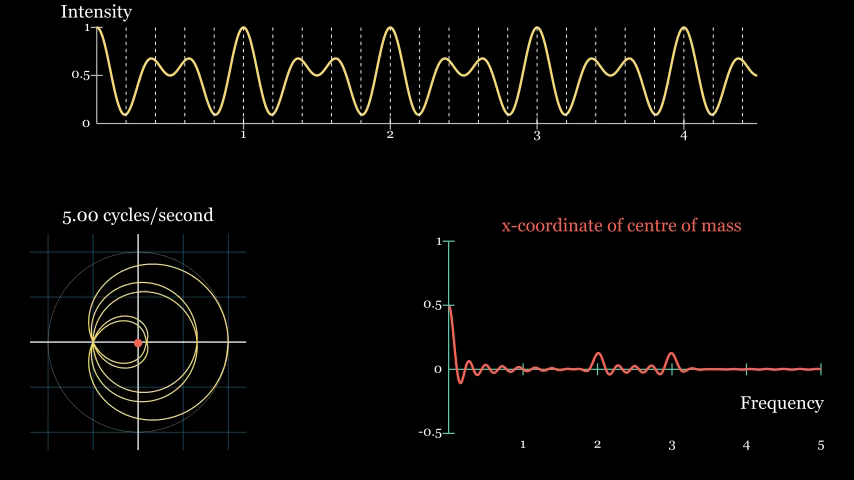

# math_explainer

Know-how and working code for making 3Blue1Brown-quality math explainer videos with
[Manim](https://github.com/ManimCommunity/manim).

Built from a teardown of two of the most successful math videos on YouTube:
[But what is the Fourier Transform?](https://www.youtube.com/watch?v=spUNpyF58BY) (12.7 M views) and
[But what is a Fourier series?](https://www.youtube.com/watch?v=r6sGWTCMz2k) (19 M views).

## Read in this order
1. [docs/01-why-these-videos-work.md](docs/01-why-these-videos-work.md): what makes them perform, enjoyable, and informative, plus a reusable structure template and target numbers
2. [docs/02-toolchain.md](docs/02-toolchain.md): every tool you need (Manim, LaTeX, audio, editing), ManimCE vs ManimGL
3. [docs/03-production-playbook.md](docs/03-production-playbook.md): checklist from idea to upload
4. [docs/04-manim-patterns.md](docs/04-manim-patterns.md): which Manim technique implements which teaching move

## Example scenes (original code, rebuilding the two signature visuals)
| Scene | What it shows |
|---|---|
| [scenes/winding_machine.py](scenes/winding_machine.py) | Signal → wound around a circle → centre of mass → "almost Fourier transform", all linked to one frequency knob |
| [scenes/epicycles.py](scenes/epicycles.py) | Complex Fourier series: rotating vectors tip to tail drawing a path (built-in heart, or any SVG) |
| [scenes/style.py](scenes/style.py) | Shared palette and helpers, with a no-LaTeX fallback |

## Quick start (macOS)
```bash
brew install cairo pango pkg-config ffmpeg uv
uv venv --python 3.12 .venv && uv pip install --python .venv -r requirements.txt
cd scenes && ../.venv/bin/manim -pql winding_machine.py WindingMachine
```
For proper maths typesetting, also install LaTeX (see the toolchain doc).

| Winding machine | Epicycles |
|---|---|
|  |  |
